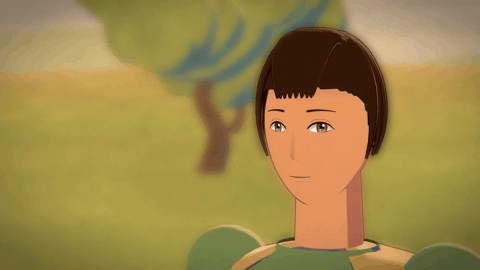
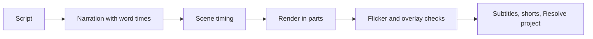
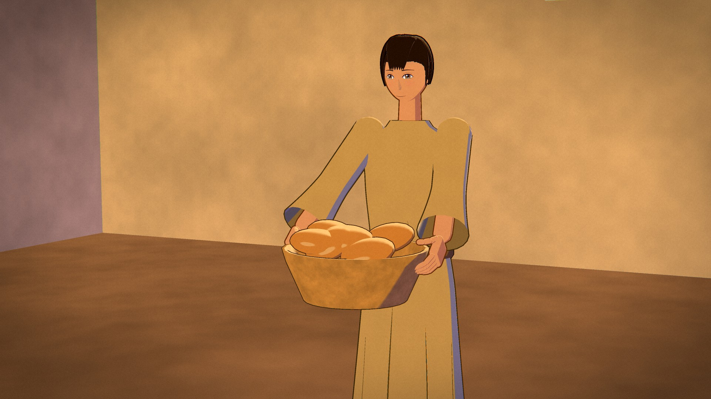
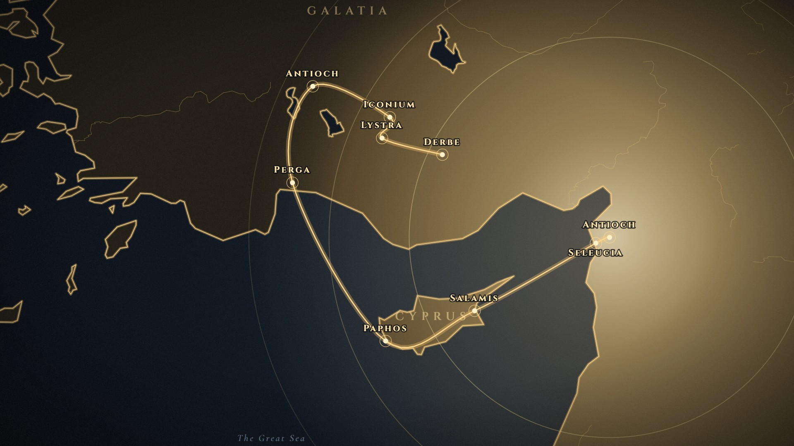
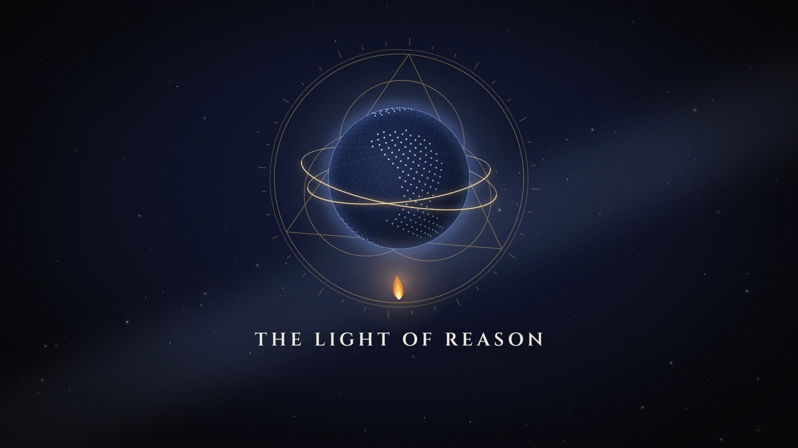

# Cel-Shaded Film Engine

A browser film engine that draws anime-style 3D characters in code, then a Python pipeline that narrates, renders, checks and delivers the film.



## Why it exists

Hand-drawn animation does not scale to a series, and a generic 3D look does not read as anime. This engine generates the characters, sets, cameras and lighting in code, with the line work and flat colour bands of modern cel-shaded animation, and it checks the frames before they ship.

## How it works



- **Picture.** three.js inside [Remotion](https://www.remotion.dev/). One WebGL2 renderer draws shadow, toon colour with outlines, then a line pass from depth, creases and object borders. Bloom, depth of field and a grade finish the frame.
- **Faces.** Heads are sculpted. The face is 2D art projected onto the head, so a mouth shape stays sharp at any size. Mouth shapes come from [Rhubarb Lip Sync](https://github.com/DanielSWolf/rhubarb-lip-sync), and the jaw opens with the voice.
- **Shots.** A shot is a subject, a size, an angle and a lens, so the same shot works in 16:9 and 9:16. Characters move on twos. The camera moves on ones.
- **Delivery.** The film renders in parts. Only a stale part is rendered again. ffmpeg encodes with NVENC. The pipeline also writes subtitles and a DaVinci Resolve project.

| Character | Map | Motion design |
|---|---|---|
|  |  |  |

## Results

The lip-sync lab above is the check for the face: the mouth changes with the line, and the head turn keeps the same character. There is no single published timing benchmark for a full film. The acceptance check is visual: flicker, z-fighting, and hands that stay inside the objects they hold.

## Quick start

```bash
cd _kit
npm install
npm run studio
npm run typecheck
```

Python 3.10 or newer, then `pip install -r _tools/requirements.txt` and `python _tools/setup.py`. Narration needs `ELEVENLABS_API_KEY` and `ELEVENLABS_VOICE_ID` in the environment. Rhubarb and the RIFE frame interpolator are not included. See the reference below.

<details>
<summary>Layout, passes and the pipeline scripts</summary>

`_kit` is the Remotion project: `src/cel` is the 3D engine, `src/mo` is 2D motion design, `src/mg` is maps, `src/promo` is a phone-promo kit. `_tools` is the Python pipeline.

The renderer (`engine.ts`) uses one shared WebGL2 context, supersampled targets, and an anime compositing chain. Materials (`toon.ts`) use two hue-shifted shadow bands, hard speculars and a constant-width outline. Contact and occlusion are enforced every frame (`contact.ts`, `qa.ts`).

| Step | Scripts |
|---|---|
| Machine and film | `setup.py`, `scaffold.py` |
| Narration | `narrate.py`, `vo_variants.py`, `words.py` |
| Timing | `plan.py` |
| Before render | `preflight.py`, `lint_scenes.py`, `preview.py` |
| Render | `parts.py`, `render_parts.mjs`, `pipeline.py` |
| After render | `flicker_qa.py`, `overlay_qa.py` |
| Delivery | `srt.py`, `shorts.py`, `interp.py`, `resolve_drp.py` |
| Lip sync | `lipsync.py` |

`setup.py` checks Node, Remotion, ffmpeg with NVENC, the GPU, and CPU and RAM. Scripture checks read public-domain Bible texts that are not included.

</details>

## How it was built

Built by directing AI coding agents in Cursor. I set the look and the acceptance bar. The agents wrote the code.

Rhubarb Lip Sync and rife-ncnn-vulkan are third-party binaries. Remotion and three.js are their own projects. This repo has no license file: all rights reserved.
